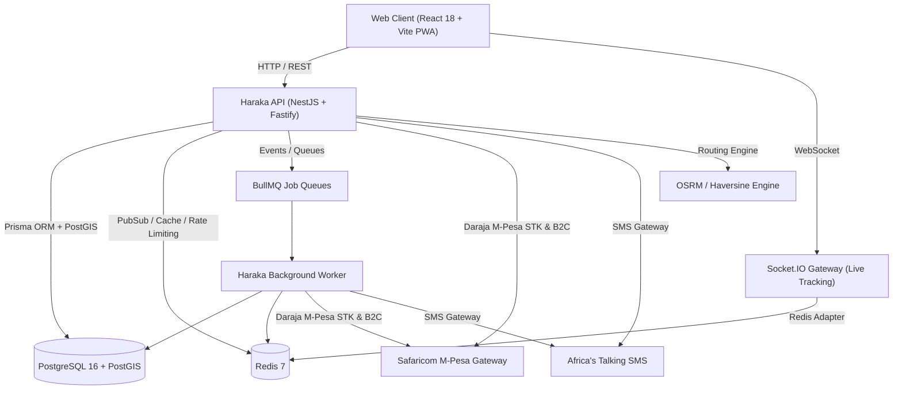

# Haraka — System Architecture & Module Boundaries

## 1. High-Level Architecture

Haraka is architected as a modular monolith deployed via Docker containers or Node.js runtime, organized in a pnpm monorepo.



---

## 2. Monorepo Structure

```
haraka/
├── apps/
│   ├── api/            # NestJS + Fastify REST API, Socket.IO gateway, OpenAPI
│   ├── worker/         # BullMQ background job processor (notifications, dispatch)
│   └── web/            # Single React 18 + Vite PWA serving all 5 roles
├── packages/
│   ├── database/       # Prisma schema, migrations, seeders, PostGIS SQL
│   ├── shared-types/   # Shared TypeScript domain types, DTOs, enums
│   ├── validation/     # Shared Zod validation schemas
│   ├── api-client/     # Typed API client with Axios
│   ├── theme/          # Design tokens, CSS variables, SVG logos, Tailwind
│   ├── i18n/           # English & Swahili translations
│   └── config/         # Shared environment and configuration utilities
└── infrastructure/
    ├── docker/         # Dockerfiles for api, worker, web
    ├── proxy/          # Caddy reverse proxy configuration
    ├── prometheus/     # Metrics scraping config
    └── grafana/        # Dashboards
```

---

## 3. Communication & Data Flow

1. **Synchronous REST API**: Fastify adapter, Zod validation, JWT authentication, cookie refresh rotation, strict RBAC guards.
2. **Real-time Live Updates**: Socket.IO with `@socket.io/redis-adapter` for multi-instance scaling. Dedicated rooms for:
   - `merchant:{id}`: Job status updates and rider location stream.
   - `rider:{id}`: Incoming job offers and dispatch events.
   - `public-tracking:{token}`: Sanitized rider GPS coordinates and ETA updates.
   - `dispatchers`: Real-time fleet overview.
3. **Asynchronous Background Processing (target architecture)**: The accepted design is to write `outbox_events` within the primary database transaction and have workers dispatch SMS with retries and dead-letter handling. This flow is not complete: business services currently send SMS synchronously, no producer is connected to the notification BullMQ queue, and payment reconciliation handlers are not implemented. See [IMPLEMENTATION_STATUS.md](./IMPLEMENTATION_STATUS.md).
