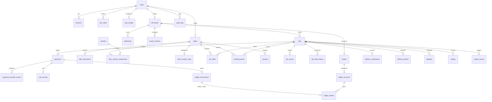

# Haraka — Database Schema & Data Dictionary

## 1. Overview
Haraka uses PostgreSQL 16 with PostGIS extension for spatial queries. All primary keys are UUIDv4 generated with `gen_random_uuid()`. 
All monetary values are stored in integer minor units (1 KES = 100 units).
Timestamps are UTC `TIMESTAMPTZ` with `created_at` and `updated_at`.

---

## 2. Entity Relationship Overview



---

## 3. PostGIS Spatial Operations
- Coordinates stored as `geography(Point, 4326)` for geodesic calculations.
- Candidate rider spatial search uses `ST_DWithin(rider_location, pickup_location, search_radius_meters)`.
- GiST spatial indexing on `rider_location_state` and `addresses`.
- Nearest available rider query:
```sql
SELECT r.id, r.user_id,
       ST_Distance(rl.geom, ST_SetSRID(ST_MakePoint($pickupLng, $pickupLat), 4326)::geography) AS distance_meters
FROM riders r
JOIN rider_location_state rl ON r.id = rl.rider_id
WHERE r.verification_status = 'APPROVED'
  AND r.online_status = 'ONLINE'
  AND rl.is_stale = false
  AND ST_DWithin(rl.geom, ST_SetSRID(ST_MakePoint($pickupLng, $pickupLat), 4326)::geography, $maxDistanceMeters)
ORDER BY distance_meters ASC
LIMIT 5;
```

---

## 4. Double-Entry Ledger Schema
- Accounts: `PLATFORM_REVENUE`, `MERCHANT_PAYABLE`, `RIDER_PAYABLE`, `CASH_IN_TRANSIT_RIDER`, `MPESA_CLEARING`.
- Ledger transactions enforce balanced entries:
$$\sum \text{Debit} - \sum \text{Credit} = 0$$
- Entries are immutable. Erroneous postings require reversal transactions (`REVERSAL`).
