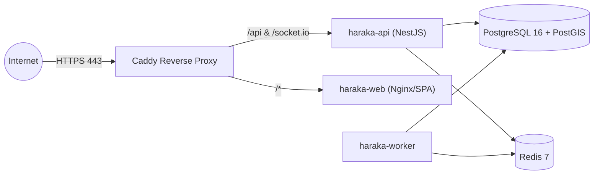

# Haraka — Production Deployment Guide

## 1. Production Architecture Overview
Haraka uses containerized deployments orchestrated via Docker Compose or Kubernetes, reverse-proxied by Caddy (automatic Let's Encrypt TLS).



---

## 2. Docker Compose Deployment

```bash
# 1. Clone repository on production host
git clone https://github.com/haraka-logistics/haraka.git /opt/haraka
cd /opt/haraka

# 2. Configure production environment
cp .env.example .env
nano .env  # set secure passwords, secrets, and API keys

# 3. Build and launch containers
docker compose -f docker-compose.prod.yml up -d --build

# 4. Run database migrations
docker compose -f docker-compose.prod.yml exec api pnpm db:migrate:deploy

# 5. Check health status
curl -f http://localhost:3000/health
```

---

## 3. Rollback Procedure
If a deployment fails:
1. Revert container image tags in `docker-compose.prod.yml` to the previous release.
2. Execute `docker compose up -d` to switch traffic.
3. Apply compensating database migrations if non-breaking; do not automatically run destructive rollback commands on live production databases.
